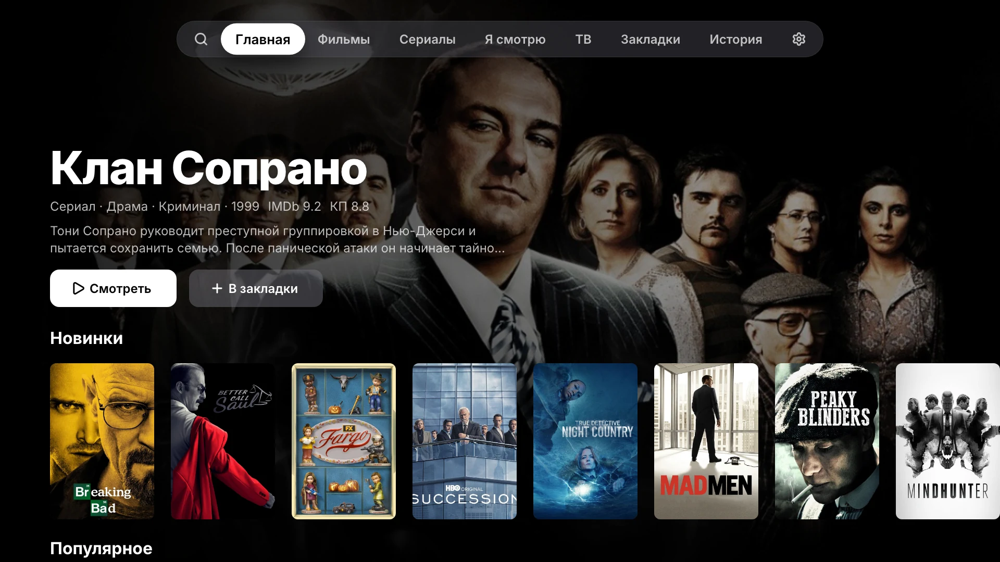
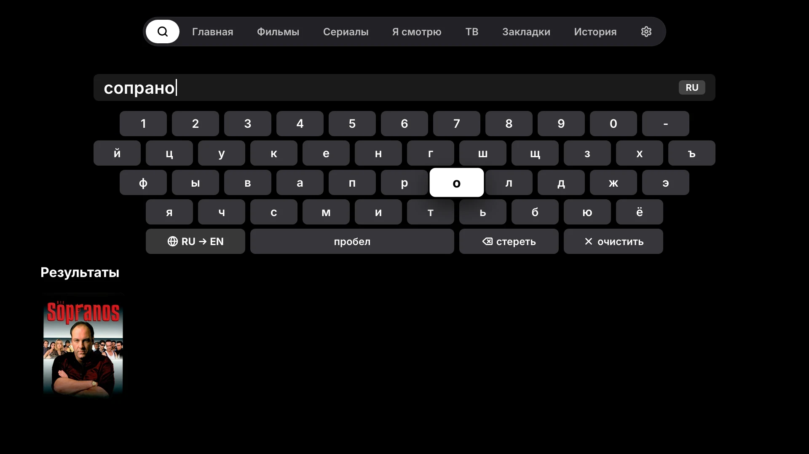
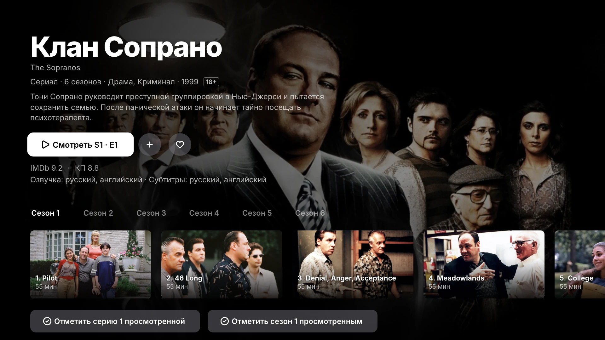

# KinoTV

**An unofficial [kino.watch](https://kino.watch) client for Samsung Tizen TVs.**
Browse films and series with your remote and play them through Samsung AVPlay.
You need your own kino.watch account with an active subscription. No companion
server is required. KinoTV is not affiliated with Samsung or kino.watch.

[Русский](README.md) · [Install and sign locally](docs/installation.md) ·
[Contribute](CONTRIBUTING.md) ·
[Report an ordinary bug](https://github.com/dartyuhov/kinotv/issues)



| Search | The Sopranos |
| --- | --- |
| [](docs/screenshots/search.webp) | [](docs/screenshots/the-sopranos.webp) |

*Captured in KinoTV’s TV layout with sample catalog data and artwork via [TVmaze](https://www.tvmaze.com/).*

## Project status

KinoTV is in development and maintained on a best-effort basis, with no promised
response times. Public release downloads are not available yet. The selected
distribution format is an **unsigned `KinoTV.wgt`**, which you sign on your
computer with your own Samsung TV certificate before installation. No maintainer
signing certificate is distributed or required.

The agreed initial verification baseline is macOS and a Samsung Q60C running
Tizen 9 / Chromium 120, matching the observed development setup. Baseline
selection is not launch acceptance or a guarantee for other models,
firmware, or hosts. The design targets Tizen 6.5+; the build targets Chrome 85,
while the generated manifest declares `required_version="3.0"`. None of these
lower bounds establishes tested compatibility. Linux is unverified, and the
project has no documented Windows installer route.

## Features

The interface is primarily Russian and uses arrows, **OK**, and **Back**. Current
source includes these features:

- Home rows, film/series catalogs, filters, search, and collections.
- Title details, seasons, episodes, and watched/unwatched episode/season actions.
- **Я смотрю** (I Watch), bookmark folders, and **История** (History/resume).
- **ТВ** (Live TV) for available service channels.
- Playback position synchronization, audio/subtitle/quality selection, seeking,
  and next-episode navigation.
- Device-code sign-in, a startup-tab preference, and artwork-cache controls.

These descriptions incorporate source inspected on November 17, 2026, including
pending application changes. That source removes the Sport tab; the documentation
branch at `0c70c46` still contains its earlier unavailable-sport screen. The final
release candidate must reconcile this difference. Source inspection and browser
fixtures do not establish native TV playback or launch readiness.

## Install and sign in

Follow the [installation guide](docs/installation.md) for SDK setup, Developer
Mode, your TV's DUID, Samsung author/distributor certificates, local signing,
installation, and same-certificate updates. Until a release is published, use the
[source-build instructions](CONTRIBUTING.md#build-and-install-on-a-tv).

Once releases exist, download `KinoTV.wgt`, `install.sh`,
`kinotv-installer.mjs`, and `SHA256SUMS` from **one selected release**. Check all
three payloads against `SHA256SUMS` before executing the bootstrap or installer.
These checks establish integrity, not independent publisher authenticity.
The bootstrap itself must also come from that selected release. From its
download folder, run each command separately and stop on failure. Replace
`v1.2.3` with the selected tag:

```sh
shasum -a 256 -c SHA256SUMS
bash ./install.sh --help
bash ./install.sh --release v1.2.3
```

Stop if any check fails. The bootstrap checks the downloaded installer and WGT;
without `--release`, it resolves `latest` once for all downloads. With
`--wgt ./KinoTV.wgt`, it downloads only the selected release's installer and
checksum manifest: your local widget isn't release-checksummed or required to
match that tag. Its KinoTV identity and version are inspected before signing,
and the fresh signed output is checked against the input before installation.
See the guide for
[direct installer and manual signing routes](docs/installation.md#sign-and-install-the-downloaded-widget).

Keep `~/KinoTV` (or your chosen `KINOTV_DIR`) to reuse saved TV/profile choices.
Updates require the **same author certificate**, not just the same profile name.
Back up `author.p12` and its password; a saved profile name isn't that backup.
The source `tools/install.sh` has a repository placeholder; use the assembled
release asset. These instructions don't imply that a public release exists yet.

On first launch, scan the QR code or open the address displayed on the TV on your
phone/computer. Sign in to kino.watch there and approve the TV's code. Each
installation obtains its own account tokens; a distributed widget must not
contain somebody else's account session. Release users don't enter OAuth client
credentials. Source builders need configured app credentials for real sign-in;
fixture-backed contributor checks don't.

## Remote controls

Use the following controls during browsing and playback:

| Button | Action |
| --- | --- |
| Arrows / OK | Move focus / select; OK toggles playback in the player |
| Back | Close a panel, hide player controls, or return; confirm exit at the root |
| Left / right in player | Seek; holding increases the step |
| Up in player | Audio, subtitle, and quality settings |
| Play/pause | Toggle playback |
| Rewind / fast-forward | Back 10 seconds / forward 30 seconds |
| CH up / down | Next/previous episode; change channels in Live TV |
| Home | Return to Smart Hub; native pause/resume behavior needs device checks |

## Limitations and evidence

4K, HDR, codecs, audio tracks, subtitles, and channel availability depend on the
TV and upstream streams. A browser's HTML5 player or FakePlayer cannot prove
Samsung AVPlay picture, sound, subtitle rendering, or suspend/resume behavior.
Artwork caching and long-session behavior also require device verification.
Known timing-sensitive checks and earlier results are recorded in the
[integrated TV checklist](docs/integrated-tv-acceptance.md); historical results
don't certify the eventual release candidate.

Launch preparation has four separate evidence categories:

| Category | Status of this guide |
| --- | --- |
| Prepared locally | Draft guides and contributor instructions; candidate checks still belong to the selected revision |
| Configured on GitHub | Not established by documentation; release/check/settings readback is separate |
| Published | No public release assets available yet |
| Installation verified | Public-download signing, fresh install, native playback, and retained-session upgrade are pending |

The approved [automatic release flow](docs/releases.md) opens a version/changelog
PR after fixes or features reach `main`. Merging that trusted release PR approves
automatic publication after exact-merge checks and hosted draft validation. App
setup and hosted operation are pending; this source change doesn't establish a
published release or physical TV acceptance.

## License

KinoTV's original code is licensed under the [MIT License](LICENSE), with
`Copyright (c) 2026 Dzmitry Artsiukhou`. Preserve the full license when you
redistribute it. Release assembly includes it in the widget and installer;
the shell bootstrap carries the full text in its comment header.

Third-party code, icons, and fonts retain their separate licenses. See
[Third-party notices](THIRD_PARTY_NOTICES.md) for attribution and full texts.

## Contribute and report

Start with [CONTRIBUTING.md](CONTRIBUTING.md) for a credential-free setup and
focused checks. Use [GitHub Issues](https://github.com/dartyuhov/kinotv/issues)
for nonsensitive bugs and proposals; you don't need the internal Beads tracker.
Include app version/source, host, TV model/firmware, reproduction steps, and
sanitized results. Don't attach account tokens, stream URLs, passwords, or
signing material. Email sensitive findings privately to
[darst94@gmail.com](mailto:darst94@gmail.com), with credentials and account data
redacted. Don't submit sensitive findings in a public issue or PR.

The original [design document](docs/superpowers/specs/2026-11-02-kinotv-tizen-app-design.md)
contains historical plans, not a current compatibility or feature guarantee.
