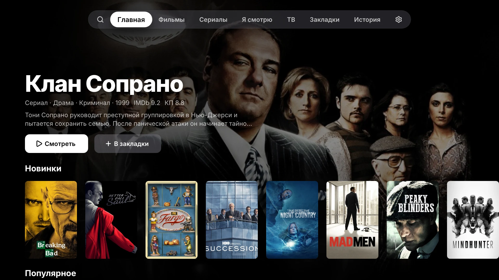
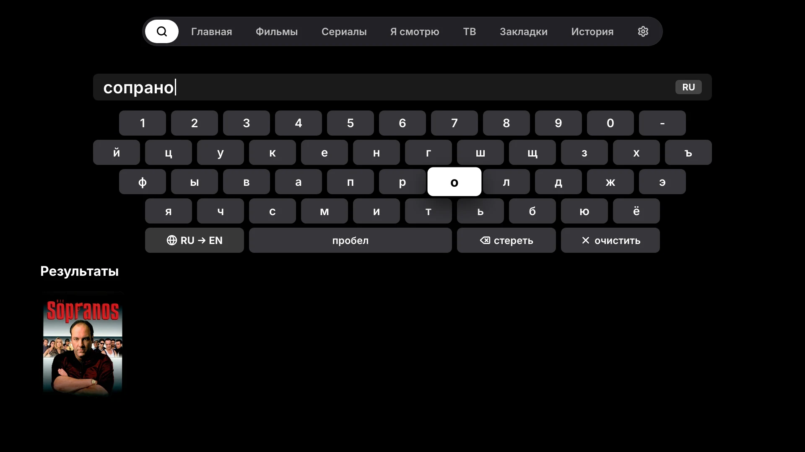
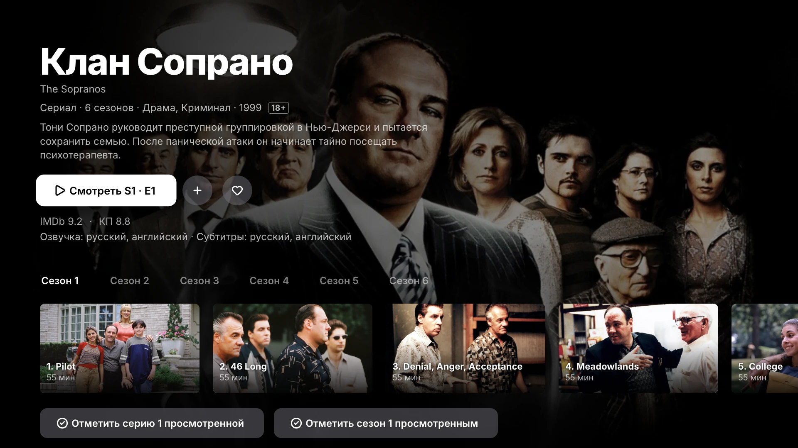

# KinoTV

**Фильмы и сериалы с [kino.watch](https://kino.watch) на Samsung Smart TV.**
Неофициальный клиент для Tizen: интерфейс на русском языке, управление пультом
и продолжение просмотра с сохранённого места. KinoTV не связан с Samsung
или kino.watch. Для просмотра нужен собственный аккаунт с действующей подпиской.
Видео воспроизводит Samsung AVPlay; отдельный сервер не нужен.

[English](README.en.md) · [Подробная установка и подпись](docs/installation.md) ·
[Участие в разработке](CONTRIBUTING.md) ·
[Сообщить об обычной ошибке](https://github.com/dartyuhov/kinotv/issues)



| Поиск | Сериалы/Фильмы |
| --- | --- |
| [](docs/screenshots/search.webp) | [](docs/screenshots/the-sopranos.webp) |

*Интерфейс KinoTV для телевизора с демонстрационным каталогом. Изображения — с [TVmaze](https://www.tvmaze.com/).*

## Возможности

Для навигации достаточно стрелок, **OK** и **Назад**. Текущие исходники включают:

- **Главную:** продолжение просмотра, новые серии, новинки и подборки.
- **Каталог фильмов и сериалов:** фильтры по типу, жанру, году и стране;
  сортировку по новизне, популярности и рейтингу.
- **Поиск:** экранную клавиатуру с русской и английской раскладками.
- **Карточки:** описание, сезоны, серии, прогресс и отметки
  «просмотрено / не просмотрено» для серий и сезонов.
- **«Я смотрю»**, папки закладок и **Историю** с переходом к просмотру.
- **ТВ:** доступные каналы сервиса в прямом эфире.
- **Плеер:** озвучку, субтитры, качество, перемотку и следующую серию.
- **Синхронизацию:** сохранение позиции в аккаунте kino.watch.
- **Вход по коду:** подтверждение на телефоне без ввода пароля пультом.
- **Настройки:** начальную вкладку и управление кэшем изображений.

Описание учитывает исходники, просмотренные 17 ноября 2026 года, в том числе
ещё не интегрированные изменения приложения. В них вкладка «Спорт» удалена;
база этой ветки документации `0c70c46` ещё содержит прежний экран недоступности
спорта. Перед релизом описание нужно сверить с окончательным кандидатом.
Наличие кода и браузерных тестов не подтверждает работу на реальном телевизоре.

## Статус и совместимость

Проект в разработке и поддерживается по мере возможностей, без гарантированных
сроков ответа. **Публичные релизы пока недоступны.** Выбран формат распространения
**неподписанного `KinoTV.wgt`**: пользователь подписывает его на своём компьютере
собственным сертификатом Samsung с DUID телевизора. Сертификат сопровождающего
проекта не требуется и не распространяется.

| Что | Текущее состояние |
| --- | --- |
| Согласованная начальная среда проверки | macOS; Samsung Q60C, Tizen 9 / Chromium 120; соответствует наблюдавшейся среде разработки |
| Целевая совместимость | Tizen 6.5+; это цель, а не проверка всех моделей и прошивок |
| Технические нижние границы | Сборка для Chrome 85, манифест `required_version="3.0"`; сами по себе не подтверждают совместимость |
| Другие компьютеры | Linux не проверен; документированного установщика для Windows нет |
| 4K, HDR, звук и субтитры | Зависят от телевизора, кодеков и потоков |
| Приёмка запуска | Установка из публичных файлов и обновление с сохранением сеанса ещё не подтверждены |

Наблюдавшаяся Q60C не означает поддержку всех Q60C или всех версий Tizen 9.
Нативные изображение/звук, субтитры, выход в Smart Hub, длительная работа
и кэш изображений требуют отдельной проверки. Исторические результаты
и незавершённые проверки перечислены в
[чек-листе телевизора](docs/integrated-tv-acceptance.md).

## Установка на телевизор

Приложения нет в магазине Samsung. Для установки нужны компьютер и режим
разработчика. Подробный английский
[путеводитель по установке](docs/installation.md) содержит ручные команды,
проверку версии, подпись, обновление и диагностику. Краткий порядок на русском:

1. Подготовьте Mac в одной сети с телевизором, Node.js **22.18+**, аккаунт Samsung
   Developer и аккаунт kino.watch с подпиской.
2. Установите Tizen SDK с Web CLI, `sdb`, TV Extension и Samsung Certificate
   Extension по [инструкции Samsung](https://developer.samsung.com/smarttv/develop/getting-started/setting-up-sdk/installing-tv-sdk.html).
   Для графического Certificate Manager используйте Tizen Studio либо
   [расширение Samsung Tizen TV для VS Code](https://developer.samsung.com/smarttv/develop/tools/additional-tools/vscode-extension-new.html).
   На Apple Silicon инструменты SDK могут потребовать Rosetta.
3. На телевизоре откройте **Apps**, введите **1 2 3 4 5**, включите
   **Developer mode**, укажите IP **компьютера** в **Host PC IP**
   и перезапустите телевизор. Запишите отдельно IP **телевизора**.
4. Подключитесь через Device Manager или `sdb connect IP_ТЕЛЕВИЗОРА:26101`.
   Сохраните DUID: его показывает мастер KinoTV; он также доступен в сведениях
   о телевизоре (**Support → About This TV / Contact Samsung → Unique Device ID**).
5. Создайте профиль **Samsung → TV**, например `KinoTV`, в Certificate Manager.
   Создайте **Author certificate** и сохраните резервную копию `author.p12`
   вместе с паролем. Для обновлений нужен **тот же авторский сертификат**,
   а не просто прежнее имя профиля или аккаунт Samsung.
6. Создайте **Distributor certificate**, выберите **Public**, добавьте DUID
   своего телевизора и завершите профиль. В Device Manager разрешите
   **Permit to install applications** для подключённого телевизора.
7. Когда релиз появится, скачайте файлы именно одной выбранной версии со
   [страницы Releases](https://github.com/dartyuhov/kinotv/releases).
   Набор — `KinoTV.wgt`, `install.sh`, `kinotv-installer.mjs` и `SHA256SUMS`.
   Сам `install.sh` тоже скачайте из выбранного релиза. Проверьте контрольные
   суммы всех трёх файлов до запуска; они подтверждают целостность относительно
   `SHA256SUMS`, но не подлинность издателя.
8. Подпишите неподписанный WGT своим профилем и установите по
   [подробному руководству](docs/installation.md#sign-and-install-the-downloaded-widget).
   До публикации используйте сборку из исходников ниже.

После публикации и проверки файлов из одной версии откройте терминал в папке
загрузки. Например, для выбранного тега `v1.2.3` (замените на реальный тег):

```sh
bash ./install.sh --help
bash ./install.sh --release v1.2.3
```

Скрипт загружает установщик и WGT выбранного релиза и проверяет их по его
`SHA256SUMS`. Без `--release` он один раз определяет `latest` и использует этот
тег для всех загрузок. Сам запущенный `install.sh` себя не проверяет.
С `--wgt ./KinoTV.wgt` из выбранного релиза берётся только установщик;
локальный WGT не проверяется по релизным суммам и не обязан совпадать с тегом.
Его идентификаторы и версия всё равно проверяются до и после подписи.

Загрузки и настройки профиля хранятся в `~/KinoTV` или `$KINOTV_DIR`.
Сохраняйте эту рабочую папку и прежний авторский сертификат для обновлений:
одно имя профиля не заменяет исходный `author.p12`. Старый подписанный WGT
удаляется перед подписью, а новая версия проверяется до установки.
Прямой запуск скачанного установщика и ручная подпись описаны в
[подробном руководстве](docs/installation.md#sign-and-install-the-downloaded-widget).
Исходный `tools/install.sh` с `OWNER/REPO` не является готовым релизным файлом.

## Первый запуск

Для входа нужен телефон или компьютер с доступом к аккаунту kino.watch.

1. Откройте KinoTV на телевизоре.
2. Отсканируйте QR-код или откройте адрес, показанный на экране.
3. Войдите в kino.watch и подтвердите код телевизора.
4. Дождитесь главной страницы, выберите фильм или серию и нажмите **Смотреть**
   или **Продолжить**.

Пользователь готового релиза не вводит параметры OAuth-приложения.
У каждой установки свои токены аккаунта; сеанс сопровождающего проекта
не должен попадать в распространяемый пакет. Если код не появляется в своей
сборке, проверьте наличие параметров приложения перед пересборкой — это
не логин и пароль от сайта.

## Управление пультом

Основные действия доступны без цветных и цифровых кнопок:

| Кнопка | Действие |
| --- | --- |
| ↑ ↓ ← → | Перемещение по интерфейсу |
| OK | Выбор; в плеере — воспроизведение или пауза |
| Назад | Закрыть панель или вернуться; на главном экране — подтверждение выхода |
| ← / → в плеере | Перемотка; при удержании шаг увеличивается |
| ↑ в плеере | Настройки озвучки, субтитров и качества |
| ⏯ | Воспроизведение / пауза |
| ⏪ / ⏩ | Назад на 10 секунд / вперёд на 30 секунд |
| CH ▲ / CH ▼ | Следующая / предыдущая серия; в ТВ — переключение каналов |
| Home | Smart Hub; сохранение позиции и возобновление требуют нативной проверки |

В плеере **Назад** сначала закрывает открытую панель, затем скрывает управление,
а следующим нажатием возвращает к карточке.

## Обновление и частые ошибки

Для обновления скачайте новую версию, проверьте её, подпишите **прежним
авторским сертификатом** и установите поверх, не удаляя приложение. Сохранение
сеанса и настроек — ожидаемое поведение, которое ещё нужно подтвердить
для публичного релиза. Уведомление в настройках не устанавливает обновление.

| Проблема | Что проверить |
| --- | --- |
| `Can't reach the TV` | Одна сеть, Developer Mode, IP компьютера в Host PC IP, перезапуск ТВ |
| `Author certificate not match` | Найдите прежний `author.p12`; новый профиль с тем же именем не заменяет его |
| `Invalid certificate chain`, `1010` | DUID именно этого ТВ в сертификате распространителя, срок действия сертификатов |
| Установка запрещена | **Permit to install applications** в Device Manager |
| Нет кода входа в своей сборке | Наличие `VITE_KP_CLIENT_ID` и `VITE_KP_CLIENT_SECRET`, затем пересборка |
| Нет видео, звука или субтитров | Подписка, сеть, другой поток/качество; приложите обезличенный отчёт |

Удаление приложения для смены авторского сертификата приводит к потере локальных
настроек и входа. Не начинайте с удаления. Подробности и ручной путь есть в
[руководстве по установке](docs/installation.md).

## Разработка и сборка

Для свежей копии нужны Git, Node.js **22.18+** и npm. Тестовые проверки не требуют
OAuth, подписки или телевизора:

```sh
git clone https://github.com/dartyuhov/kinotv.git
cd kinotv
npm ci
npm run typecheck
npm test
npm run build
npx playwright install chromium
npm run e2e
```

Для реального входа скопируйте `.env.example` в `.env.local`, только если
локального файла ещё нет, и укажите параметры **OAuth-приложения**, не токены
аккаунта. `VITE_*` включаются в пакет и доступны получателям. Сопровождающий
выбрал заимствованные параметры публичного клиента `kpapp.link` для настроенных
сборок; это не новый клиент KinoTV и не утверждение о разрешении от сервиса.
Значения не хранятся в примере. Подробнее — в
[CONTRIBUTING.md](CONTRIBUTING.md#configure-real-device-code-sign-in).

| Команда | Назначение |
| --- | --- |
| `npm run dev` | Разработка в браузере |
| `npm run typecheck` / `npm test` | Типы / модульные тесты |
| `npm run e2e` | Chromium с тестовыми API и FakePlayer |
| `npm run build` | Сборка `dist/`; сама по себе не проверяет реальный вход |
| `npm run tv:setup` | Настройка SDK, подключения и профиля Samsung |
| `npm run package` | `dist-tizen/KinoTV.wgt`; подписан только при наличии профиля и CLI |
| `npm run tv` / `npm run tv:debug` | Сборка, подпись, установка и запуск / с DevTools |

Перед `npm run tv` проверьте наличие обоих эффективных production-параметров
Vite командой из [инструкции для разработчиков](CONTRIBUTING.md#build-and-install-on-a-tv),
которая выводит только `present` / `missing`.

В браузере стрелки и Enter заменяют пульт, Backspace/Escape — «Назад»,
Space — паузу, `[` / `]` — перемотку, Page Up / Page Down — CH ▲ / CH ▼.
`VITE_PLAYER=fake npm run dev` заменяет только плеер, но не API и вход.
TV-инструменты ищутся в `PATH` и `$TIZEN_HOME` (по умолчанию `~/tizen-studio`).
`KINOTV_TV` и `KINOTV_TIZEN_PROFILE` переопределяют сохранённые настройки.

## Лицензия

Оригинальный код KinoTV распространяется по [лицензии MIT](LICENSE):
`Copyright (c) 2026 Dzmitry Artsiukhou`. При распространении сохраняйте полный
текст лицензии. Сборка релизных файлов включает его в WGT и установщик;
shell-скрипт содержит полный текст в заголовке-комментарии.

Сторонние библиотеки, значки и шрифты сохраняют собственные лицензии.
Атрибуция и полные тексты указаны в
[Third-party notices](THIRD_PARTY_NOTICES.md).

## Обратная связь и готовность запуска

Обычные ошибки и предложения отправляйте в
[Issues](https://github.com/dartyuhov/kinotv/issues). Укажите модель/прошивку ТВ,
версию приложения, способ установки, шаги и ожидаемый/фактический результат.
Не публикуйте пароли, токены, приватные URL потоков и сертификаты.
Чувствительные сообщения отправляйте приватно на
[darst94@gmail.com](mailto:darst94@gmail.com), удалив учётные данные и данные
аккаунта. Не отправляйте такие сообщения в публичные Issues или PR.

Готовность разделяется на четыре независимые части: локальная подготовка,
настройка GitHub, публикация и проверка установки. Эти инструкции — локальный
черновик; они не подтверждают остальные три части. Итоговый запуск зависит
от проверки публичных файлов, входа, нативного воспроизведения и обновления
на согласованном телевизоре.

Утверждён [автоматический выпуск](docs/releases.md): после исправлений и новых
функций в `main` бот создаёт PR с версией и changelog. Слияние этого релизного PR
разрешает автоматическую публикацию после проверок точного merge-коммита и всех
файлов черновика. Отдельно создавать тег или нажимать Publish не нужно.
Настройка GitHub App и проверка работы в GitHub ещё не завершены; изменение
исходников не подтверждает публикацию или физическую проверку на ТВ.

Правила участия — в [CONTRIBUTING.md](CONTRIBUTING.md). Исходная
[проектная спецификация](docs/superpowers/specs/2026-11-02-kinotv-tizen-app-design.md)
содержит исторические планы; текущая реализация может отличаться.
